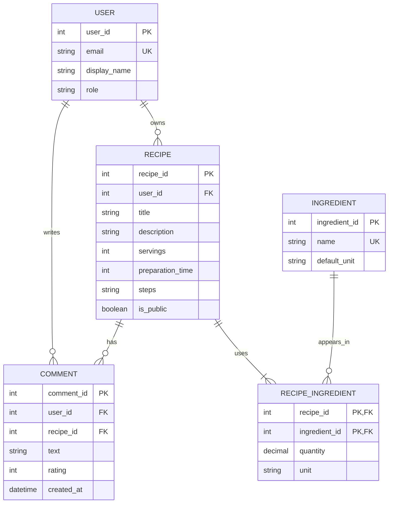

# Podatkovni model – Recipe Box

## ER-diagram

## Pojasnilo povezav

1. **User – Recipe (1:N):** En uporabnik lahko ustvari več receptov, vsak recept pa pripada enemu uporabniku. Tuji ključ `user_id` je v tabeli `Recipe`, ker določa lastnika recepta.

2. **User – Comment (1:N):** En uporabnik lahko napiše več komentarjev, vsak komentar pa pripada enemu uporabniku. Tuji ključ `user_id` je v tabeli `Comment`, ker določa avtorja komentarja.

3. **Recipe – Comment (1:N):** En recept ima lahko več komentarjev, vsak komentar pa se nanaša na en recept. Tuji ključ `recipe_id` je v tabeli `Comment`, ker določa recept, ki je komentiran.

4. **Recipe – RecipeIngredient (1:N):** En recept vsebuje eno ali več sestavin, vsaka vrstica v `RecipeIngredient` pa pripada enemu receptu. Tuji ključ `recipe_id` je v tabeli `RecipeIngredient`.

5. **Ingredient – RecipeIngredient (1:N):** Ena sestavina se lahko pojavi v več receptih, vsaka vrstica v `RecipeIngredient` pa se nanaša na eno sestavino. Tuji ključ `ingredient_id` je v tabeli `RecipeIngredient`.

## Povezava M:N

Povezava med `Recipe` in `Ingredient` je M:N, saj lahko recept vsebuje več sestavin, ista sestavina pa se lahko pojavi v več receptih.

Zato uporabimo vezno entiteto `RecipeIngredient`, ki vsebuje tuja ključa `recipe_id` in `ingredient_id` ter dodatna atributa `quantity` in `unit`.